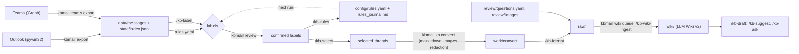

# kb-email (`kbmail`)

Turn your Outlook mailbox (and calendar, and optionally Teams chats) into a **reviewed, area-labeled,
continuously updated knowledge base** that GitHub Copilot in VS Code can use to answer questions,
suggest which emails need attention, and draft replies in your own style.

* **Python (`kbmail` CLI)** does everything deterministic: export via pywin32, de-duplication and
  delta tracking, rule-based labeling, markitdown conversion, redaction, queues, wiki bookkeeping
  (diffs, lint, confidence decay, search, graph), relationship statistics.
* **Copilot** (latest VS Code) does the parts that need judgement, through
  [agent skills](https://agentskills.io) that also work as `/` commands (`/kb-label`, `/kb-rules`,
  `/kb-select`, `/kb-format`, `/kb-wiki-ingest`, `/kb-draft`, ...). Each one reads a file kbmail
  prepared and writes a result file in a fixed format, which kbmail validates and imports. A **KB
  Librarian** custom agent ties them together, and a session-start hook gives it the current state.
* **You** confirm labels, describe images when Copilot vision is off, and answer open questions.

Nothing needs an API key: the only LLM is the Copilot you already have in VS Code.



## Install (Windows, classic Outlook)

Uses [uv](https://docs.astral.sh/uv/) (`winget install astral-sh.uv`). uv also installs a suitable
Python if you don't have one.

```powershell
git clone https://github.com/reecemiao/kb-email
cd kb-email
uv tool install -e ".[teams]"   # puts `kbmail` on PATH; drop [teams] if you don't need the Teams exporter
kbmail init C:\kb               # creates your private workspace (config, skills, agent, wiki skeleton)
```

`uv tool install -e` keeps the install linked to the clone, so `git pull` updates it (rerun the command
when dependencies change). Then run `kbmail init C:\kb --upgrade` to refresh the workspace's skills,
agent, hook and schema (your config, `.env` and wiki pages are never overwritten).

Edit `C:\kb\kbmail.yaml` (`me.emails`, `areas` with descriptions/keywords, `copilot.vision`), then open
`C:\kb` in VS Code. In the Chat view, pick the **KB Librarian** agent and type `/kb-start`; Copilot
walks you through the first run.

Requirements: Python 3.12+, classic Outlook desktop (the new WebView-based Outlook has no COM API),
current VS Code with GitHub Copilot. Skills, the custom agent and `AGENTS.md` are picked up
automatically, and the hook needs `kbmail` on PATH. The workspace is separate from this repo, so your
mail never ends up in the tool's git history.
Version the workspace in a *private* repo if you like; that also gives the wiki a full audit history.

On macOS/Linux, or for testing, `kbmail import-eml <folder>` imports saved `.eml` files instead of
exporting from Outlook. Everything else works the same.

## Settings: `kbmail.yaml` and `.env`

Every setting has a built-in default, and every CLI option that isn't a one-off action (ids, paths,
`--force`) reads its default from a setting. You can set them in `kbmail.yaml` or as
`KBMAIL_<SECTION>__<KEY>` variables in a `.env` file or the environment. Precedence, highest first:

1. command-line flag, e.g. `kbmail export --include-subfolders`
2. environment variable, e.g. `$env:KBMAIL_OUTLOOK__INCLUDE_SUBFOLDERS = "true"`
3. `.env` in the current directory
4. `.env` in the workspace root
5. `kbmail.yaml`
6. built-in default

`kbmail init` writes `.env.example` with every setting, its default and a one-line description. It
also creates an all-commented `.env` (git-ignored in the workspace) that you can edit; just uncomment
lines. `kbmail init --upgrade` regenerates `.env.example` and never touches `.env`.

```dotenv
KBMAIL_ME__EMAILS=taro.yamada@contoso.com,t.yamada@contoso.co.jp
KBMAIL_OUTLOOK__DAYS=60
KBMAIL_OUTLOOK__FOLDERS=inbox,sent,Inbox/Projects
KBMAIL_COPILOT__VISION=false
KBMAIL_REVIEW__ACCEPT_ABOVE=0.95
KBMAIL_SYNC__TEAMS=true
KBMAIL_WORKSPACE=C:\kb        # lets you run kbmail from any folder
```

Values are parsed by the default's type. Booleans take `true`/`false`. Lists are comma-separated
(`a,b`) or YAML (`[a, b]`). An empty value (`KEY=`) counts as not set. Unknown `KBMAIL_*` names
print a warning, and invalid values stop the command with the variable's name.
`kbmail config show [prefix]` prints each effective value, where it came from and its variable name.
`kbmail config env` prints a fresh template.

## First run, step by step

| # | what | who | command / skill |
|---|---|---|---|
| 1 | Export mail + calendar for the last *n* days. Default: Inbox + Sent Items, subfolders skipped | kbmail | `kbmail export --days 30` (`--include-subfolders`, `--all-folders`, `--folder "Inbox/Projects"`, `--no-calendar`) |
| 2 | Rough labeling into your areas + `others` | Copilot | `kbmail label prepare` → `/kb-label` → `kbmail label import` |
| 3 | Confirm or correct every label | you | `kbmail review` (Enter = accept, `1,2` = set areas, `v` view, `b` back, `q` quit) or `kbmail review export-csv` / `import-csv` for Excel |
| 4 | Turn confirmed labels into deterministic rules | Copilot | `kbmail rules prepare` → `/kb-rules` (edits `config/rules.yaml`, iterates with `kbmail rules evaluate`, then `kbmail rules commit`) |
| 5 | Pick threads with durable knowledge | Copilot | `kbmail kb prepare` → `/kb-select` → `kbmail kb import` |
| 6 | Convert selected mail + attachments (markitdown), then clean them into `raw/` | kbmail + Copilot | `kbmail kb convert` → `/kb-format` |
| 7 | Images: vision **off** → you describe them in `review/images/descriptions.yaml` (preview `REVIEW.md`), vision **on** → `/kb-images`. SVGs are text, so `/kb-svg` turns diagrams into Mermaid either way | you / Copilot | `kbmail images import` (or `kbmail images describe`) |
| 8 | Answer what Copilot didn't understand; give links to documentation | you | edit `review/questions.yaml` (or `kbmail questions answer`), then `kbmail questions ingest` (fetches URLs into `raw/web/`). Drop your own documents into `raw/inbox/` → `kbmail raw import` |
| 9 | Build the wiki (LLM Wiki v2: tiers, confidence, supersession, typed graph) | Copilot | `kbmail wiki queue` → `/kb-wiki-ingest` → `kbmail wiki lint` → `/kb-wiki-lint` |
| 10 | Draft mail on a topic / reply to a message; get suggestions of what to send or answer | Copilot | `/kb-style` once; then `/kb-draft`, `/kb-suggest` (uses `kbmail triage`), `kbmail draft-outlook drafts/x.md` puts a draft in Outlook (never sends) |
| 11 | Infer people and relationships | kbmail + Copilot | `kbmail people build` → `/kb-people` (corrections in `config/people.yaml`) |

`kbmail status` shows at any time what is done and the next action. `/kb-ask` answers questions from
the wiki with citations and can file good answers back into it.

## Later runs: deltas only

`kbmail sync` (or `/kb-sync` in Copilot, which runs it and then works through the queues):

* **(a) mail export:** each folder keeps a watermark (newest `ReceivedTime`) in
  `state/export_state.json`. The next export starts at the watermark minus `overlap_hours` and
  de-duplicates by Internet Message-ID against `state/index.jsonl`. Calendar re-scans from the last
  run (meetings get edited), and future events are always re-scanned.
* Rules label new mail first (`status: auto`); only what the rules can't decide goes to `/kb-label`,
  and only new proposals appear in `kbmail review`. Spot-check rule labels with
  `kbmail review --source auto`.
* **(b) rule refresh:** `state/runs.json` records each `rules commit` (time, confirmed-label count,
  coverage, accuracy). A refresh is due after `rules.refresh_every_days` or
  `rules.refresh_after_new_confirmed` new confirmations. `kbmail rules prepare` hands Copilot the
  evaluation, mistakes, mined signals, labels confirmed since last time **and the previous conclusions**
  from `config/rules_journal.md`. Each committed version is snapshotted in `state/rules_history/`.
* KB selection works per thread. A thread is re-assessed only when it gets new messages, and
  conversion only re-runs when the selected messages change. `/kb-format` updates the existing raw file.
* **(c) wiki:** `state/wiki_manifest.json` stores the sha256 of every raw file at ingest time, and
  `state/wiki_snapshots/` keeps a copy. `kbmail wiki queue` lists new, changed and deleted raw files;
  a changed file comes **with a unified diff**, so Copilot integrates only what changed.
  `kbmail wiki mark` records the ingest (audit trail in `state/wiki_audit.jsonl` + `wiki/log.md`).

Schedule the deterministic part daily with Windows Task Scheduler (Outlook COM needs your logged-in
session, so choose "Run only when user is logged on"):

```powershell
schtasks /Create /SC DAILY /ST 08:30 /TN kbmail-sync /TR "cmd /c cd /d C:\kb && %USERPROFILE%\.local\bin\kbmail.exe sync >> state\sync.log 2>&1"
```

When you next open VS Code, `/kb-sync` picks up the prepared queues.

## Teams

The same pipeline works on Teams chats: each chat-day becomes one record (`source: teams`). The
recommended route is Microsoft Graph with delegated `Chat.Read` (`kbmail teams export`). It needs an
app registration your tenant allows. An experimental Outlook route reads the hidden
`TeamsMessagesData` folder when your profile exposes it (`kbmail teams probe-outlook`). See
[docs/teams.md](docs/teams.md) for what is feasible and what is not.

## More

* [docs/architecture.md](docs/architecture.md): workspace layout, file formats, state files, design decisions
* [docs/copilot.md](docs/copilot.md): VS Code / Copilot setup: skills, KB Librarian agent, hook, vision on/off, automation
* [docs/teams.md](docs/teams.md): Teams feasibility and setup

## Development

Tooling: [uv](https://docs.astral.sh/uv/) for environments and the lockfile, [ruff](https://docs.astral.sh/ruff/)
for linting and formatting (config in `pyproject.toml`), [pre-commit](https://pre-commit.com/) to run both
on every commit.

```bash
uv sync --all-extras          # .venv with runtime + Teams extras + dev group (pytest, ruff, pre-commit)
uv run pre-commit install     # hooks for commit (ruff, uv-lock, file hygiene) and push (pytest)
uv run pytest                 # tests
uv run ruff check --fix . && uv run ruff format .
uv run kbmail --help          # run the CLI from the checkout
```

Add dependencies with `uv add <pkg>` (or `uv add --group dev <pkg>`) so `uv.lock` stays in sync; the
`uv-lock` hook rejects commits where it isn't.

The tests run the whole pipeline on generated `.eml` files. They write the result files Copilot
would write, then check export de-duplication, labeling import, interactive review, rule
validation/evaluation/snapshots, KB selection with questions, markitdown conversion (HTML tables,
docx, inline images, SVG), redaction, quote stripping, image description flow, wiki delta queue with
diffs, lint/decay, hybrid search, people statistics and triage. The pywin32 exporter is tested against
a fake Outlook object model. Real Outlook and the Graph (Teams) calls need Windows and a tenant, so test
those on your machine.
